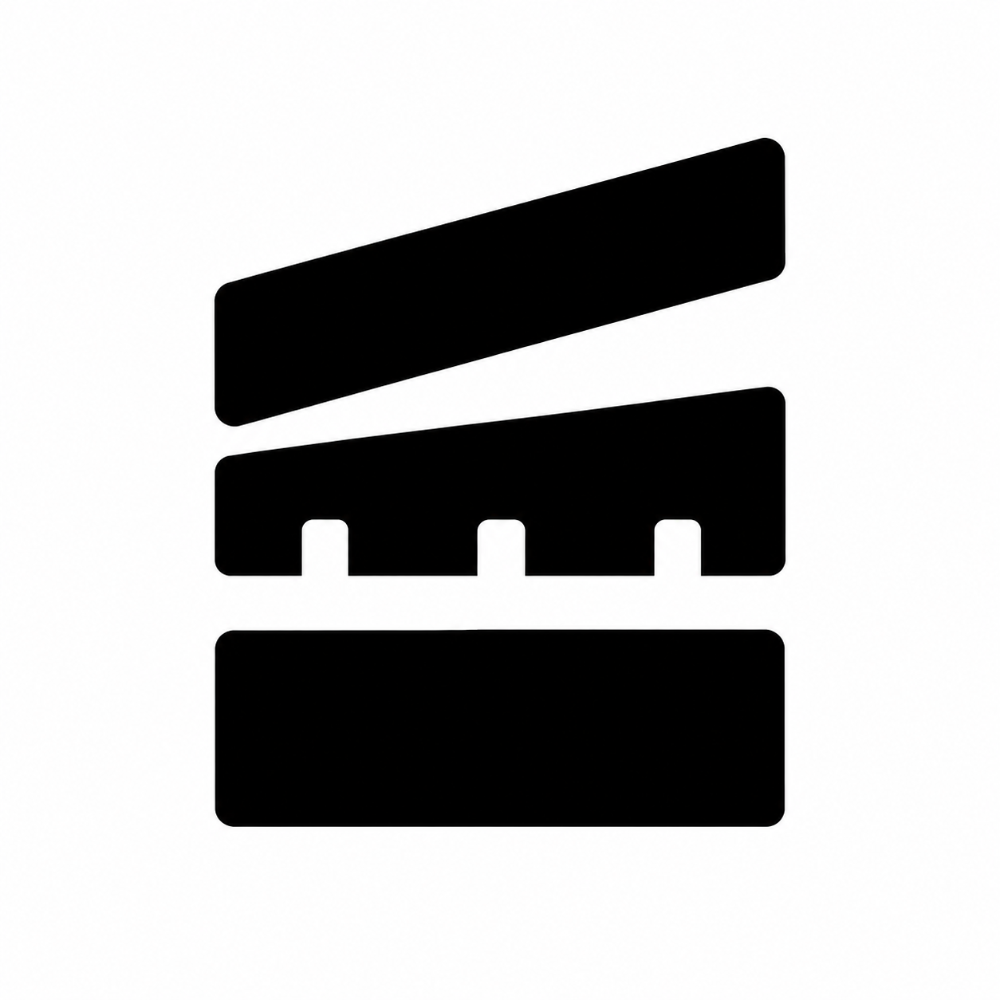

<p align="center">
  
</p>

<h1 align="center">Cutlass</h1>

<p align="center">
  <b>말을 걸 수 있는 어시스턴트가 있는 무료 오픈 소스 동영상 편집기.</b><br>
  macOS, Windows, Linux 지원.
</p>

<p align="center">
  <a href="https://github.com/1mrnewton/cutlass/releases/latest"></a>
  <a href="https://github.com/1mrnewton/cutlass/actions/workflows/ci.yml"></a>
  <a href="#license"></a>
</p>

<p align="center">
  <a href="#download">다운로드</a> ·
  <a href="#what-you-can-do">기능</a> ·
  <a href="#the-assistant">어시스턴트</a> ·
  <a href="#formats">포맷</a> ·
  <a href="#build-from-source">빌드</a> ·
  <a href="#not-here-yet">아직 없는 것</a> ·
  <a href="https://cutlass.sh">웹사이트</a>
</p>

[English](../../README.md) · [简体中文](README.zh-CN.md) · [繁體中文](README.zh-TW.md) · [日本語](README.ja.md) · **한국어** · [Español](README.es.md) · [Português](README.pt-BR.md) · [Français](README.fr.md) · [Deutsch](README.de.md) · [Italiano](README.it.md) · [Русский](README.ru.md) · [العربية](README.ar.md) · [हिन्दी](README.hi.md) · [Bahasa Indonesia](README.id.md)

Cutlass는 타임라인 동영상 편집기입니다. 영상, 소리, 사진을 가져와 트랙 위에서 자르고, 텍스트와 효과와 색을 더한 다음, 완성된 동영상을 내보냅니다. 모든 단계를 직접 할 수도 있고, 원하는 편집을 평범한 말로 설명해서 어시스턴트가 타임라인에서 하게 할 수도 있습니다. 그 결과는 바꾸거나 실행 취소할 수 있습니다.

무료입니다. 계정도, 워터마크도, 업로드도 없습니다. 영상은 내 디스크에 그대로 있고, 머신 러닝을 쓰는 도구는 내 컴퓨터에서 실행됩니다.

편집기 아래의 코덱은 우리가 직접 만든 것입니다. H.264, HEVC, AV1, ProRes, AAC, Opus를 비롯한 코덱이 이 저장소 안에 Rust로 작성되어 있습니다. Cutlass는 FFmpeg를 포함하지 않습니다.

<a name="download"></a>
## 다운로드

| 시스템 | 파일 |
| --- | --- |
| macOS, Apple 실리콘 | [Cutlass.dmg](https://github.com/1mrnewton/cutlass/releases/latest/download/Cutlass.dmg) |
| Windows, 64비트 | [Cutlass-setup.exe](https://github.com/1mrnewton/cutlass/releases/latest/download/Cutlass-setup.exe) |
| Linux, x86_64 | [Cutlass-x86_64.AppImage](https://github.com/1mrnewton/cutlass/releases/latest/download/Cutlass-x86_64.AppImage) |

[릴리스](https://github.com/1mrnewton/cutlass/releases) 페이지에는 모든 파일 옆에 `.sha256` 체크섬이 있습니다. 설치한 뒤에는 Cutlass가 새 릴리스를 스스로 확인합니다. 메뉴의 **Check for updates…** 입니다.

빌드가 아직 개발자 인증서로 서명되지 않아서, 처음 실행할 때 한 단계가 더 필요합니다.

- **macOS:** 앱을 한 번 연 다음, System Settings › Privacy & Security 에서 **Open Anyway** 로 허용합니다.
- **Windows:** SmartScreen이 설치 프로그램을 막으면 **More info** › **Run anyway** 를 선택합니다.
- **Linux:** `chmod +x Cutlass-x86_64.AppImage` 로 파일을 실행할 수 있게 만든 다음 실행합니다.

<a name="what-you-can-do"></a>
## 할 수 있는 것

**타임라인에서 자르기.** 비디오, 오디오, 텍스트 트랙. 분할, 트림, 빈 곳 닫기, 프레임 정지, 역재생, 미러, 회전, 자르기. 클립을 그룹으로 묶거나, 컴파운드 클립으로 접어 두었다가 나중에 열 수 있습니다. 편집 내용을 유지한 채 클립을 교체하거나, 한 클립의 속성을 다른 클립에 복사할 수 있습니다. 무거운 영상은 프록시로 편집할 수 있습니다.

**속도와 움직임.** 일정한 속도를 정하거나, 속도 곡선을 고르고 점을 끌어서 모양을 바꿉니다. 키프레임으로 클립을 움직이고, 키프레임 여러 개를 한 번에 옮기거나 지울 수 있습니다. 인, 아웃, 콤보 애니메이션을 바로 적용할 수 있습니다.

**색.** 기본 조정, HSL, 곡선, 컬러 휠. `.cube` LUT를 불러오고 그 아래에서도 피부 톤을 자연스럽게 유지합니다. 필터 200개와 타임라인 위의 조정 레이어.

**효과와 전환.** 효과 200개, 전환 180개, 블렌드 모드 13가지. 클립을 선, 미러, 원, 사각형, 하트, 별 모양으로 마스크합니다. 그린 스크린을 지우거나, 물체를 클릭해서 오려 냅니다.

**텍스트, 자막, 스티커.** 텍스트에 글꼴, 외곽선, 그림자, 배경, 말풍선, 효과를 넣고 인, 아웃, 반복 애니메이션을 줄 수 있습니다. 자막은 내 컴퓨터에서 클립의 소리를 듣고 만들어지며(지금은 영어만), 그다음 목록으로 편집합니다. 한 줄을 다시 입력하고, 찾아 바꾸고, 템플릿을 고르고, 단어 하나하나에 스타일을 주고, 결과를 SRT 파일로 내보냅니다. 스티커와 도형은 다른 클립처럼 타임라인에 놓입니다.

**내 컴퓨터에서 실행되는 화면 도구.** 흔들림 보정, 화질 향상, 화면 노이즈 줄이기, 부드러운 슬로 모션을 위한 옵티컬 플로, 리라이트, 자동 리프레임, 모션 블러. 어디로도 보내지 않습니다.

**소리.** 볼륨과 페이드, 동영상에서 오디오 추출, 소리를 기준으로 비디오와 오디오 동기화, 비트 표시.

**내보내기.** MP4 또는 MOV로 타임라인 전체, 범위, 선택한 클립을 내보냅니다. 소리만, GIF, 움직이는 WebP도 내보낼 수 있습니다. macOS와 Windows에서는 가능할 때 시스템의 하드웨어 코덱이 작업하고, 설정의 스위치로 끌 수 있습니다.

<a name="the-assistant"></a>
## 어시스턴트

원하는 것을 말하면, 어시스턴트가 타임라인이 보내는 것과 같은 요청으로 열려 있는 프로젝트를 편집합니다. 어시스턴트가 한 변경은 하나하나가 실행 취소 한 단계입니다.

- **내 컴퓨터에서 실행됩니다.** 어시스턴트는 [Ollama](https://ollama.com), llama.cpp 서버, LM Studio처럼 내 컴퓨터에 있는 모델 러너와 대화합니다. 주소와 모델은 Settings › Assistant 에서 정합니다. 이 경로에서는 프롬프트가 내 컴퓨터를 떠나지 않습니다.
- **먼저 묻습니다.** 데이터를 컴퓨터 밖으로 보내게 되는 일은 내가 허용할 때까지 기다립니다.
- **스킬이 있습니다.** 자막, 공백 제거, 모션 그래픽, 제품 데모, 프로젝트 설정이 앱에 들어 있고, 내가 추가한 MCP 서버의 도구도 호출할 수 있습니다.
- **다른 에이전트도 Cutlass를 다룰 수 있습니다.** `cutlass mcp /path/to/project` 는 창 없이 같은 도구를 stdio로 제공하므로, Claude나 어떤 MCP 클라이언트든 프로젝트를 읽고 편집할 수 있습니다.

<a name="formats"></a>
## 포맷

아래의 디코더와 인코더는 [`crates/codecs`](../../crates/codecs) 와 [`crates/containers`](../../crates/containers) 에 있는 Rust 코드이며, FFmpeg를 외부 기준으로 삼아 테스트합니다. 대부분의 크레이트는 무엇을 지원하는지에 대한 기록을 소스 옆에 둡니다.

| | 열기 | 내보내기 |
| --- | :---: | :---: |
| **파일** | MP4, MOV, M4V, M4A, WAV, AIFF, FLAC, Ogg, MP3 | MP4, MOV, 그리고 소리만 |
| **비디오** | H.264, HEVC, AV1, ProRes, VP8, MPEG-4, MPEG-2, Motion JPEG | H.264, ProRes, VP8, MPEG-4, MPEG-2, Motion JPEG. HEVC는 macOS와 Windows에서 시스템 인코더로 내보냅니다 |
| **소리** | AAC, MP3, FLAC, ALAC, Opus, Vorbis, AC-3, E-AC-3, PCM | AAC, MP3, FLAC, ALAC, Opus, Vorbis, AC-3, E-AC-3, PCM |
| **사진** | JPEG, PNG, WebP, GIF, 움직이는 것과 정지 이미지 모두 | GIF, 움직이는 WebP |

<a name="build-from-source"></a>
## 소스에서 빌드하기

안정 버전 [Rust](https://rustup.rs) 툴체인과 C 컴파일러가 필요합니다. Linux에서는 GTK와 ALSA 헤더도 필요합니다.

```sh
sudo apt-get install libgtk-3-dev libasound2-dev
```

그다음:

```sh
git clone https://github.com/1mrnewton/cutlass
cd cutlass
cargo run --release -p cutlass
```

CI가 실행하는 검사(마지막 것은 [cargo-nextest](https://nexte.st) 가 필요합니다):

```sh
cargo fmt --all -- --check
cargo clippy --workspace --all-targets -- -D warnings
cargo nextest run --workspace
```

<a name="not-here-yet"></a>
## 아직 없는 것

Cutlass는 아직 젊은 프로젝트입니다. 앱에서 그려져 있지만 아직 만들어지지 않은 기능은 흐리게 표시되고 **Later** 라고 적혀 있어서, 무엇이 동작하는지 언제나 알 수 있습니다. 지금의 큰 빈자리는 다음과 같습니다.

- **더 많은 컨테이너.** MKV, WebM, AVI, MPEG-TS 파일은 아직 열리지 않습니다.
- **음성 도구.** 노이즈 줄이기, 음성 향상, 음량 정규화, 음성 분리, 텍스트 음성 변환.
- **생성형 도구.** AI 지우기, 확장, 스타일 변환.
- **추적.** 대상을 따라가는 텍스트, 스티커, 마스크.
- **더 많은 언어의 자막.**
- **어시스턴트를 위한 호스팅 모델.** 지금은 로컬 모델을 씁니다.
- **휴대폰.** iOS와 Android 앱은 [`apps`](../../apps) 에 있고 같은 Rust 코어를 공유하지만, 데스크톱이 먼저입니다.

문제를 일으킨 파일이 함께 있는 버그 보고가 보내 주실 수 있는 것 중 가장 도움이 됩니다. [이슈 열기](https://github.com/1mrnewton/cutlass/issues).

## 코드 구성

| 폴더 | 들어 있는 것 |
| --- | --- |
| [`apps/desktop`](../../apps/desktop) | 데스크톱 편집기, egui 창입니다. `cutlass` 바이너리를 빌드합니다 |
| [`apps/ios`](../../apps/ios), [`apps/android`](../../apps/android) | SwiftUI와 Kotlin Compose로 만든 휴대폰 앱. `crates/ffi` 를 통해 Rust 코어를 사용합니다 |
| [`crates/model`](../../crates/model), [`crates/session`](../../crates/session), [`crates/editor`](../../crates/editor) | 프로젝트, 실행 취소가 되는 편집 요청, 모든 앱이 공유하는 편집기 동작 |
| [`crates/eval`](../../crates/eval), [`crates/engine`](../../crates/engine), [`crates/render`](../../crates/render), [`crates/playback`](../../crates/playback), [`crates/export`](../../crates/export) | 미리 보기와 내보내기를 위해 프로젝트와 시각을 한 프레임과 그 소리로 바꾸는 부분 |
| [`crates/codecs`](../../crates/codecs), [`crates/containers`](../../crates/containers) | 코덱마다, 파일 형식마다 크레이트 하나 |
| [`crates/platform-apple`](../../crates/platform-apple), [`crates/platform-windows`](../../crates/platform-windows) | 시스템의 하드웨어 코덱 |
| [`crates/effects`](../../crates/effects), [`crates/text`](../../crates/text), [`crates/captions`](../../crates/captions) | 필터, 효과, 전환, 마스크, 색, 텍스트, 자막 |
| [`crates/vision`](../../crates/vision), [`crates/transcription`](../../crates/transcription) | 기기에서 실행되는 화면 모델과 음성 모델 |
| [`crates/agent`](../../crates/agent) | 어시스턴트: 그 도구, 스킬, MCP |

## 기여하기

실제 영상으로 Cutlass를 써 보고 어디에서 문제가 생기는지 알려 주세요. [이슈 양식](https://github.com/1mrnewton/cutlass/issues/new/choose)은 버그, 기능, 성능, 열리지 않는 파일을 다룹니다.

코드를 보내시나요? 먼저 위의 세 가지 검사를 실행해 주세요. 공유 크레이트는 특정 플랫폼에 묶이지 않으므로, 같은 편집이 데스크톱과 휴대폰에서 모두 동작합니다.

<a name="license"></a>
## 라이선스

Cutlass는 두 라이선스 중 어느 쪽으로든 무료입니다. 하나를 고르세요.

* [Apache License 2.0](../../LICENSE-APACHE)
* [MIT License](../../LICENSE-MIT)

Copyright (c) 2026 1mrnewton

